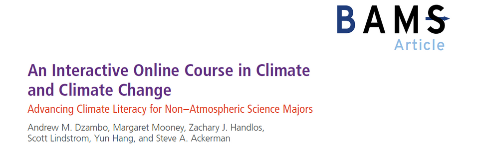

<!-- Hidden page (not in the menu), as on the original site. -->

## University of Texas Health Science Center at Houston

### PH 2362 Environmental Epidemiology (2025 - )

Role: Instructor 
Audience: Graduate students regardless of major 
Description: This course introduces students to the principles and methods of environmental epidemiology, emphasizing the application of remote sensing and machine learning in modeling environmental exposures. Topics include study design, exposure assessment, statistical analysis, and interpretation of epidemiological findings related to air quality, extreme weather, natural disasters, and other environmental factors such as light at night. The course focuses on practical applications to develop skills for research and to support public health decision-making.



### PH 2110 Public Health Ecology and Human Environment (2024 - )

Role: Instructor 
Audience: Public health and medical students at UTHealth and sister institutions 
Description: This course provides an introductory overview of the basic principles underpinning public health ecology and environmental health. Students will gain foundational knowledge in public health ecology, environmental health principles, and an introduction to environmental policies and controls. The knowledge acquired will be applied to an environmental case study, where students will use a systems thinking approach to identify key elements of the problem, develop solutions, and create a dissemination plan. Additionally, inter-professional engagement simulations will equip students with skills for effectively engaging stakeholders, including community members, policymakers, enforcers, and other healthcare professionals.

## Emory University

### EH 586 Advanced Seminar in Climate Change and Health: Research Frontiers, Assessments and Practices (2021 - 2023)

Role: Co-Instructor 
Audience: Graduate students in the Rollins School of Public Health regardless of major 
Description: This course offers an advanced examination of climate and health research and solutions. On the research side, it uses an in-depth climate health impact assessment study to demonstrate scientific premises, study design, data access and processing, research methodologies, results visualization, and interpretation. On the solutions side, it unpacks the history and current state of global and national climate policy while diving deep into state and local efforts. Additionally, it explores emerging topics related to climate change research and policy. Throughout the semester, students will work on a project contributing to the Georgia Climate Project, a multi-university consortium co-founded by Emory. Through this effort, students will apply systems thinking tools to propose strategies and identify stakeholders important for implementing climate solutions.

## University of Wisconsin-Madison

### ES 956 Advanced Environmental Remote Sensing (2020)

Role: Co-Instructor 
Audience: Graduate students in the Nelson Institute for Environmental Studies 
Description: This course teaches the fundamental physical principles of terrestrial remote sensing, followed by an examination of advanced topics in earth observation and digital image processing. Topics include radiation interaction with the atmosphere and the surface, radiative transfer theory, land surface characteristics including energy balance, thermal sensing, atmospheric and radiometric correction of image data, and automated cloud detection and removal. The course includes hands-on image processing using open-source software such as GDAL, Google Earth Engine, and Python.

### AOS 100 Climate and Weather + AOS 101 Climate and Weather Lab (2019)

Role: Teaching Assistant + Instructor 
Audience: Undergraduate students in the Department of Atmospheric and Oceanic Sciences 
Description: This course teaches the nature and variability of wind, temperature, clouds, and precipitation. It covers storm systems, fronts, thunderstorms, tornadoes, and their prediction; air composition and pollution; global winds; seasonal changes; and climate and climatic change. The course includes map analyses and basic quantitative lab exercises.

### AOS 102 Climate and Climate Change (2019) - Featured twice in the Bulletin of the American Meteorological Society

Role: Teaching Assistant 
Audience: UW-Madison students regardless of major 
Description: This course teaches the basic principles governing the climate system. It covers the current climate and climate variability, climate evolution in the past, and projected climate change in the future. The scientific principles underlying the natural and anthropogenic greenhouse effect and climate model forecasts are elucidated.

